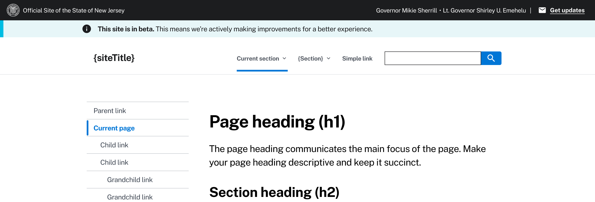

import { STORYBOOK_BASE_URL } from '@config/storybook';

<PageHeader
  name="Beta indicator"
  category="PATTERNS"
  description="Indicate a website or tool is in early development with a beta indicator."
/>
  
## Beta indicator usage

### What to do
- Use the slim version of the [info site alert](https://grove.nj.gov/reference/sitealert/#information-state) for the beta indicator.
- Add a beta indicator to websites or tools during early or limited releases.
- Remove the beta indicator when the website or tool begins to be shared publicly with a wide audience.
- Discuss with your team about if a beta indicator is appropriate for your project.

###  What not to do
- Do not design a custom component for the beta indicator.
- Do not leave the beta indicator on a page indefinitely.
- Do not use a beta indicator to indicate ongoing or iterative additions to a website generally. This should be considered a given in iterative or agile development.
- Do not default to adding a beta indicator to every new website or tool. 

## Usage guidance

### Consider value to the user
Beta or pilot indicators are tech-focused industry terms that may not mean as much to the general public. When considering whether or not to add a beta indicator to your project, think through what you are trying to communicate the the users. 
- Are you trying to set expectations about the MVP version of a site?
- Are you letting people know that more features are coming?
- Are you worried about the limited scope of use?

Talk this through with your team to decide if a beta indicator is needed for your use case.

### Have an endpoint in mind 
If you are planning on adding a beta indicator to your website or tool, have a milestone or end date in mind when you will remove the indicator. 

Possible endpoints could be: 
- When the website is publicly linked or advertised
- When the scope of users expands beyond a test group
- When a website or tool moves from MVP to V1
- After user testing has been completed and the team has confidence that the tool is ready for use

## Resources

| File | Purpose | 
| ----------- | ----------- |
| [Grove Figma page templates](https://www.figma.com/design/z8CI77qQvbffkCslHANatK/Grove--Garden-State-Design-System?node-id=3671-9658&t=1GWB72UzkvF2FYfT-0) | See placement and language of the beta indicator on page templates. |
